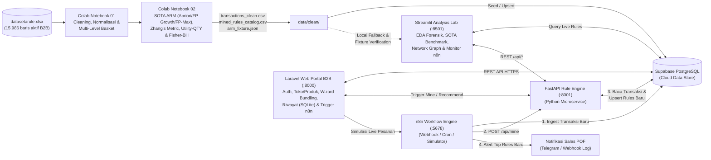

# System Architecture & Technical Specification: KeraMine

**Versi:** 0.1.0 (Arsitektur Terintegrasi Colab $\rightarrow$ Supabase $\leftrightarrow$ FastAPI + n8n $\leftrightarrow$ Streamlit)  
**Tanggal Pembaruan:** 10 Nov 2026

---

## 1. Gambaran Umum Arsitektur Sistem



### Pembagian Peran Komponen
| Komponen | Peran Utama | Alasan Pemilihan Teknis |
|---|---|---|
| **Google Colab (Notebooks 01 & 02)** | Eksplorasi data, pembersihan forensik, eksperimen SOTA, dan pembangkitan artefak kontrak (`data/clean/`) | Reproducible 100%, alur kerja terbukti di proyek sebelumnya |
| **Supabase (PostgreSQL Cloud)** | Penyimpanan terpusat (*Single Source of Truth* analitik) untuk transaksi, riwayat *mining run*, profil toko, dan katalog *rules* | Mendukung REST API instan atas HTTPS IPv4, koneksi langsung dari n8n/FastAPI/Laravel/Streamlit |
| **FastAPI (`api-engine :8001`)** | Layanan *microservice* Python yang mengeksekusi ulang algoritma FP-Growth + metrik SOTA saat dipicu oleh n8n/Laravel/Streamlit | Algoritma ARM tetap di Python (`mlxtend` + `scipy`) tanpa ditulis ulang ke PHP |
| **Laravel (`keramine-laravel :8000`)** | **Portal Web Bisnis B2B** — Login role (`Admin`, `Sales POF`, `Manajer`), Katalog 237 Toko & 438 Produk, Wizard Bundling, Riwayat & Ekspor PDF/CSV (SQLite lokal + Supabase REST API) | Antarmuka operasional SaaS matang, stabil di Windows tanpa konfigurasi driver Postgres IPv6 |
| **Streamlit (`keramine-lab :8501`)** | **Analysis Lab & Visualisasi Ilmiah** — EDA forensik (`NOTA` vs `Toko+Bulan`), *Network Graph*, SOTA Benchmark Lab, serta monitor pipeline n8n | Sangat cepat untuk grafik interaktif (Plotly & PyVis) dan eksperimen threshold *real-time* |
| **n8n (`:5678`)** | Orkestrator *pipeline* otomatis (*near-real-time*): menerima transaksi baru, memicu FastAPI, mencatat *drift*, dan mengirim alert | Visualisasi *workflow node-by-node* sangat jelas saat didemokan secara *live* di depan dosen penguji |

---

## 2. Arsitektur Matematis & Rumus SOTA Association Rules

Misalkan $B = \{b_1, b_2, \dots, b_N\}$ adalah himpunan keranjang transaksi aktif (contoh: $N = 3.949$ keranjang `Toko + Bulan` setelah baris retur `QTY <= 0` dipisahkan), dan $I = \{i_1, i_2, \dots, i_M\}$ adalah himpunan item pada level granularitas terpilih ($L \in \{\text{MERK}, \text{UKURAN}, \text{MERK\_UKURAN}, \text{SERI}, \text{NAMABARA}\}$). Untuk sebuah aturan asosiasi $A \Rightarrow C$ dengan $A, C \subset I$ dan $A \cap C = \emptyset$:

### 2.1 Metrik Klasik (Support, Confidence, Lift)
1. **Frekuensi Mutlak Keranjang:**
   $$n_A = |\{b \in B \mid A \subseteq b\}|, \quad n_C = |\{b \in B \mid C \subseteq b\}|, \quad n_{AC} = |\{b \in B \mid (A \cup C) \subseteq b\}|$$
2. **Support ($s$):**
   $$\text{Support}(A \Rightarrow C) = P(A \cap C) = \frac{n_{AC}}{N}$$
3. **Confidence ($c$):**
   $$\text{Confidence}(A \Rightarrow C) = P(C \mid A) = \frac{\text{Support}(A \cup C)}{\text{Support}(A)} = \frac{n_{AC}}{n_A}$$
4. **Lift ($l$):**
   $$\text{Lift}(A \Rightarrow C) = \frac{P(A \cap C)}{P(A)\,P(C)} = \frac{\text{Confidence}(A \Rightarrow C)}{\text{Support}(C)}$$

### 2.2 Metrik State-of-the-Art (Leverage, Conviction, Kulczynski, Zhang's Metric)
1. **Leverage:** Mengukur selisih proporsi kemunculan bersama terhadap ekspektasi independen:
   $$\text{Leverage}(A \Rightarrow C) = P(A \cap C) - P(A)\,P(C)$$
2. **Conviction:** Mengukur rasio frekuensi kesalahan prediksi jika $A$ dan $C$ independen terhadap frekuensi kesalahan aktual:
   $$\text{Conviction}(A \Rightarrow C) = \frac{1 - P(C)}{1 - \text{Confidence}(A \Rightarrow C)}$$
3. **Kulczynski ($Kulc$) & Imbalance Ratio ($IR$):** Metrik yang *null-invariant* (tidak terdistorsi oleh banyaknya keranjang yang tidak membeli kedua item, sangat cocok untuk data B2B yang *sparse*):
   $$\text{Kulc}(A, C) = \frac{1}{2}\left(P(A \mid C) + P(C \mid A)\right), \quad \text{IR}(A, C) = \frac{|n_A - n_C|}{n_A + n_C - n_{AC}}$$
4. **Zhang's Metric ($Z$):** Mengukur kekuatan asosiasi dalam rentang ternormalisasi $[-1, +1]$ ($+1$ = asosiasi positif sempurna, $0$ = independen, $-1$ = asosiasi negatif sempurna):
   $$\text{Zhang}(A \Rightarrow C) = \frac{\text{Confidence}(A \Rightarrow C) - \text{Confidence}(\bar{A} \Rightarrow C)}{\max\big(\text{Confidence}(A \Rightarrow C),\,\text{Confidence}(\bar{A} \Rightarrow C)\big)} = \frac{P(A \cap C) - P(A)P(C)}{\max\big(P(A \cap C)(1 - P(A)),\, P(A)(P(C) - P(A \cap C))\big)}$$

### 2.3 Quantity / Utility-Weighted Association Rules (Memanfaatkan Kolom `QTY`)
Karena setiap transaksi memuat jumlah kardus keramik (`QTY` dalam satuan `DUS`), setiap keranjang $b$ yang memuat $A \cup C$ memiliki utilitas volume $u(A \cup C, b) = \sum_{i \in A \cup C} \text{QTY}(i, b)$.
1. **Total Volume Utility ($U_{AC}$):** Jumlah kardus yang terjual pada seluruh keranjang tempat $A$ dan $C$ dibeli bersama.
2. **Utility Share ($u_{\text{share}}$):** Proporsi volume kardus dari aturan $A \Rightarrow C$ terhadap total volume kardus di seluruh database:
   $$u_{\text{share}}(A \cup C) = \frac{\sum_{b \supseteq A \cup C} u(A \cup C, b)}{\sum_{b \in B} u(b)}$$
3. **Utility-Weighted Score ($S_{\text{util}}$):** Skor komposit untuk memprioritaskan paket *bundling* yang tidak hanya kuat secara statistik tetapi juga menghasilkan volume pengiriman (dus) yang besar:
   $$S_{\text{util}}(A \Rightarrow C) = \text{Confidence}(A \Rightarrow C) \times \max(0, \text{Zhang}(A \Rightarrow C)) \times \log_{10}\!\left(1 + \bar{Q}_{AC}\right)$$
   dengan $\bar{Q}_{AC}$ adalah rata-rata jumlah dus per keranjang ketika $A$ dan $C$ dipesan bersama.

### 2.4 Uji Signifikansi Statistik (Fisher's Exact Test + Benjamini-Hochberg)
Untuk mencegah *spurious rules* (aturan dengan *lift* tinggi semu karena ukuran sampel kecil), setiap kandidat aturan diuji dengan tabel kontingensi $2\times 2$:

| | Memuat $C$ | Tidak Memuat $C$ | Total |
|---|---|---|---|
| **Memuat $A$** | $n_{11} = n_{AC}$ | $n_{10} = n_A - n_{AC}$ | $n_A$ |
| **Tidak Memuat $A$** | $n_{01} = n_C - n_{AC}$ | $n_{00} = N - n_A - n_C + n_{AC}$ | $N - n_A$ |
| **Total** | $n_C$ | $N - n_C$ | $N$ |

* Nilai $p$-value eksak satu-sisi (*greater*) dihitung melalui distribusi hipergeometrik (**Fisher's Exact Test**):
  $$p = \sum_{k = n_{11}}^{\min(n_A, n_C)} \frac{\binom{n_A}{k}\binom{N - n_A}{n_C - k}}{\binom{N}{n_C}}$$
* Seluruh nilai $p$ pada satu level dikoreksi dengan prosedur **Benjamini-Hochberg (FDR)** menghasilkan $q\text{-value}$. Aturan diberi status `is_significant = true` apabila $p < 0,05$ (dan ditandai tingkat keemasannya bila $q_{\text{BH}} < 0,10$).

---

## 3. Skema Database Cloud (Supabase PostgreSQL)

Seluruh tabel menggunakan awalan `keramine_` agar bersih, terisolasi, dan aman meskipun dijalankan pada project Supabase bersama maupun project Supabase khusus.

| Nama Tabel | Kolom Utama | Fungsi |
|---|---|---|
| `keramine_transactions` | `id` (BIGSERIAL PK), `nota` (TEXT UNIQUE), `tgl` (DATE), `year_month` (TEXT), `year_week` (TEXT), `nama_toko` (TEXT), `kode_toko` (INT), `namabara` (TEXT), `kodebara` (INT), `merk_raw` (TEXT), `merk_clean` (TEXT), `ukuran` (TEXT), `seri` (TEXT), `merk_ukuran` (TEXT), `qty` (NUMERIC), `satuan` (TEXT), `pof` (TEXT), `is_return` (BOOLEAN), `source_batch` (TEXT), `created_at` (TIMESTAMPTZ) | Menyimpan 16.000 transaksi historis + transaksi baru yang masuk dari pipeline n8n |
| `keramine_mining_runs` | `id` (UUID PK), `triggered_by` (TEXT: `'colab_seed'`, `'n8n_webhook'`, `'n8n_cron'`, `'manual_ui'`), `basket_type` (TEXT: `'store_month'`, `'store_week'`), `item_level` (TEXT), `algorithm` (TEXT: `'fpgrowth'`, `'apriori'`, `'fpmax'`), `min_support` (FLOAT8), `min_confidence` (FLOAT8), `total_baskets` (INT), `rules_found` (INT), `significant_rules` (INT), `exec_time_ms` (FLOAT8), `created_at` (TIMESTAMPTZ) | Mencatat log eksekusi pipeline real-time n8n & benchmark algoritma |
| `keramine_rules` | `id` (TEXT PK — SHA256 dari `basket_type\|item_level\|antecedents\|consequents`), `run_id` (UUID FK), `basket_type` (TEXT), `item_level` (TEXT), `antecedents` (JSONB), `consequents` (JSONB), `antecedents_str` (TEXT), `consequents_str` (TEXT), `n_ab` (INT), `support` (FLOAT8), `confidence` (FLOAT8), `lift` (FLOAT8), `leverage` (FLOAT8), `conviction` (FLOAT8), `kulczynski` (FLOAT8), `zhang_metric` (FLOAT8), `total_qty_dus` (NUMERIC), `avg_qty_dus` (FLOAT8), `utility_score` (FLOAT8), `p_value_fisher` (FLOAT8), `q_value_bh` (FLOAT8), `is_significant` (BOOLEAN), `updated_at` (TIMESTAMPTZ) | Katalog aturan asosiasi lintas-level yang dibaca langsung oleh Dashboard Streamlit |
| `keramine_store_profiles` | `nama_toko` (TEXT PK), `kode_toko` (INT), `dominant_pof` (TEXT), `total_baskets_month` (INT), `total_unique_skus` (INT), `total_qty_dus` (NUMERIC), `top_merks` (JSONB), `top_seris` (JSONB), `top_ukurans` (JSONB), `updated_at` (TIMESTAMPTZ) | Profil 237 toko pelanggan untuk mempercepat rekomendasi *restocking* per toko |

Indeks performa:
* `idx_keramine_tx_store_month` pada `keramine_transactions(nama_toko, year_month)`
* `idx_keramine_rules_level_sig` pada `keramine_rules(basket_type, item_level, is_significant, lift DESC)`

---

## 4. Kontrak REST API (`api-engine` — FastAPI Port `8001`)

| Endpoint | Method | Payload / Parameter | Deskripsi |
|---|---|---|---|
| `/api/health` | `GET` | — | Memeriksa status layanan FastAPI, jumlah transaksi lokal/Supabase, dan koneksi DB |
| `/api/mine` | `POST` | `{"basket_type": "store_month", "item_level": "SERI", "algorithm": "fpgrowth", "min_support": 0.003, "min_confidence": 0.30, "triggered_by": "n8n_webhook"}` | Menarik transaksi aktif, menjalankan algoritma FIM + metrik SOTA + Fisher-BH, melakukan *upsert* ke `keramine_rules` & `keramine_mining_runs`, dan mengembalikan ringkasan Top-10 aturan |
| `/api/simulate-transactions` | `POST` | `{"n_baskets": 5, "target_pof": "DIAN", "inject_bundle": ["DAKOTA", "NEO"]}` | Menyuntikkan transaksi simulasi baru ke `keramine_transactions` (untuk demo *live* n8n) |
| `/api/recommend` | `GET` | `?nama_toko=...&item_level=SERI&current_items=DAKOTA&top_k=5` | Mengembalikan rekomendasi paket *bundling* berdasarkan aturan signifikan + *fallback* popularitas |

---

## 5. Struktur Direktori Proyek (`D:\TUGAS\SEMESTER 7\ADAMIN`)

```text
ADAMIN/
├── datasetarule.xlsx                        # Dataset mentah utama (16.000 baris B2B keramik)
├── Master_Dokumentasi_ADAMIN_KeraMine/      # 8 dokumen master (Single Source of Truth)
│   ├── 01_PRD_GENERAL_ADAMIN_KERAMINE.md
│   ├── 02_DESIGN_SYSTEM_ADAMIN_KERAMINE.md
│   ├── 03_ARCHITECTURE_ADAMIN_KERAMINE.md
│   ├── 04_AGENTS_ADAMIN_KERAMINE.md
│   ├── 05_DATASET_DAN_METODE_ADAMIN_KERAMINE.md
│   ├── 06_COLAB_WORKFLOW_ADAMIN_KERAMINE.md
│   ├── 07_N8N_DAN_SUPABASE_PIPELINE.md
│   └── 08_LINGKUNGAN_DAN_MEKANISME_AI_9ROUTER.md
├── Laporan_UAS_ADAMIN_KeraMine.html         # Laporan UAS Live HTML berstandar TIF UIN Suska Riau
├── notebooks/                               # Google Colab Notebooks (Fase 2 & Fase 3)
│   ├── 01_data_cleaning_basket_engineering.ipynb
│   └── 02_sota_association_rules_validation.ipynb
├── data/clean/                              # Artefak bersih hasil ekstraksi ZIP Colab
│   ├── transactions_clean.csv
│   ├── returns_log.csv
│   ├── store_profiles.json
│   ├── mined_rules_catalog.csv
│   ├── sota_benchmark_summary.json
│   └── arm_fixture.json
├── api-engine/                              # FastAPI Rule Engine Service (Port 8001)
├── keramine-app/                            # Aplikasi Utama Streamlit Dashboard (Port 8501)
├── n8n/                                     # Workflow JSON n8n & skrip simulator (Port 5678)
├── Modeling/                                # Arsip tugas mingguan Bab 5 buku North
└── Data Progress/                           # Arsip PDF buku North & latihan awal
```

