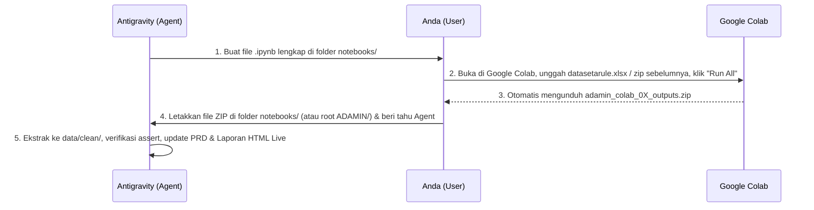

# Colab Workflow: Mekanisme Eksekusi Notebook Python KeraMine

**Versi:** 0.1.0 — Standar Alur Kerja Google Colab (Identik dengan Mekanisme Proyek SPK)

---

## 1. Daftar Notebook Proyek

Seluruh pemrosesan data dan eksperimen pemodelan *Data Mining* dijalankan melalui **Google Colab** menggunakan dua *notebook* terstruktur di folder `notebooks/`:

| Notebook | Tujuan Utama | Status Saat Ini | Artefak Output (di dalam ZIP) |
|---|---|---|---|
| `notebooks/01_data_cleaning_basket_engineering.ipynb` | Membaca `datasetarule.xlsx`, audit forensik, konversi tanggal, normalisasi typo merek (`PISSCASO`), pemisahan 146 baris `QTY = 0`, ekstraksi regex `UKURAN` & `SERI`, serta pembentukan keranjang `Toko+Bulan` & `Toko+Minggu` | ✔ Selesai | `transactions_clean.csv`, `returns_log.csv`, `store_profiles.json`, `cleaning_audit_summary.json`, `data_dictionary.md`, `basket_granularity_audit.png` (`adamin_colab_01_outputs.zip`) |
| `notebooks/02_sota_association_rules_validation.ipynb` | Menjalankan Apriori vs FP-Growth vs FP-Max pada 5 level item, menghitung metrik SOTA (*Zhang's Metric*, *Conviction*, *Leverage*, *Kulczynski*), *Utility-Weighted Rules (`QTY`)*, uji statistik *Fisher's Exact + Benjamini-Hochberg*, serta evaluasi temporal *Hit-Rate@5* | ✔ Selesai | `mined_rules_catalog.csv` (784 rules), `sota_benchmark_summary.json`, `arm_fixture.json`, `temporal_eval_report.json`, 2 grafik PNG (`adamin_colab_02_outputs.zip`) |

---

## 2. Diagram Alur Kerja Sama (Agent $\leftrightarrow$ User $\leftrightarrow$ Google Colab)

---

## 3. Standar Teknis Notebook Google Colab

1. **Bebas Peringatan `DeprecationWarning` Python 3.13 Colab:**
   * Setiap *notebook* wajib menyertakan sel penyaring `StderrFilter` di bagian paling atas (seperti yang sudah terbukti berhasil pada `Modeling/Association_Rule_Chapter5.ipynb`) agar output sel bersih dari peringatan `datetime.datetime.utcnow()` milik `jupyter_client`.
2. **Self-Contained & Idempotent:**
   * Dapat dijalankan dari awal (*Runtime $\rightarrow$ Restart session and run all*) tanpa error.
   * Menyertakan pemeriksaan `assert` pada setiap tahap kritis (contoh: memastikan jumlah baris awal = 16.000, jumlah baris `QTY <= 0` = 160, dan tidak ada nilai `NaN` pada kolom kunci).
3. **Pengemasan Otomatis (Auto-Download ZIP):**
   * Sel paling akhir pada masing-masing *notebook* secara otomatis mengompres seluruh file hasil ke dalam `adamin_colab_01_outputs.zip` / `adamin_colab_02_outputs.zip` dan memanggil `files.download(...)` supaya Anda hanya perlu mengunduh **satu file ZIP** per *notebook*.

---

## 4. Kontrak Berkas di `data/clean/`

| Nama Berkas | Dihasilkan Oleh | Digunakan Oleh |
|---|---|---|
| `transactions_clean.csv` | Colab 01 | Colab 02, Seeder Supabase, FastAPI `/api/mine`, Streamlit Tab 1 |
| `returns_log.csv` | Colab 01 | Streamlit Tab 1 (Analisis Barang Retur), Laporan Bab 4.1 |
| `store_profiles.json` | Colab 01 | Seeder `keramine_store_profiles` Supabase, Streamlit Tab 3 |
| `cleaning_audit_summary.json` | Colab 01 | Pembaruan otomatis angka eksak pada Laporan Bab 4.1 |
| `mined_rules_catalog.csv` | Colab 02 | Seeder `keramine_rules` Supabase, Streamlit Tab 2 & Tab 3 |
| `sota_benchmark_summary.json` | Colab 02 | Streamlit Tab 4 (SOTA Lab), Laporan Bab 4.2 & 4.3 |
| `arm_fixture.json` | Colab 02 | Unit test kontrak matematis antara Colab $\leftrightarrow$ FastAPI $\leftrightarrow$ Streamlit |

