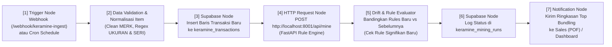

# Panduan Integrasi Supabase MCP & Arsitektur Pipeline Auto-Realtime n8n: KeraMine

**Versi:** 0.1.0 (10 Nov 2026)

---

## 1. Status Koneksi MCP Supabase

Hasil pemeriksaan langsung melalui tool `mcp_supabase_get_project_url`, `mcp_supabase_get_publishable_keys`, `mcp_supabase_apply_migration`, `mcp_supabase_list_tables`, dan `mcp_supabase_get_advisors` menunjukkan bahwa plugin **Supabase MCP di Antigravity Anda SUDAH AKTIF, TERHUBUNG, dan BEBAS BLOKIR (`skip_elicitations=execute_sql,apply_migration`)** ke project **KeraMine**:
* **Project Ref & URL:** `odtxjphklgvnpzicsysc` — `https://odtxjphklgvnpzicsysc.supabase.co`
* **Status Migrasi (`20261110162650_create_keramine_initial_schema`):** ✔ **BERHASIL** (`get_advisors(security)` = `0` peringatan keamanan, endpoint REST PostgREST merespons `HTTP 200 OK`).
* **Kredensial Lingkungan Lokal:** Tersimpan aman di [`.env`](../.env) (`SUPABASE_URL`, `SUPABASE_REST_URL`, `SUPABASE_PUBLISHABLE_KEY`, dan `SUPABASE_SECRET_KEY`).

Keempat tabel proyek telah aktif di skema `public` dengan *Row Level Security (RLS)* terkonfigurasi:
* `public.keramine_transactions` (`rls_enabled: true`)
* `public.keramine_mining_runs` (`rls_enabled: true`)
* `public.keramine_rules` (`rls_enabled: true`)
* `public.keramine_store_profiles` (`rls_enabled: true`)

---

## 2. Arsitektur Pipeline Auto-Realtime dengan **n8n**

Tujuan pipeline **n8n** pada `KeraMine` adalah mendemonstrasikan bagaimana model *Association Rule Mining* bertransformasi dari eksperimen statis menjadi **sistem rekomendasi yang memperbarui dirinya secara otomatis (*near-real-time*)** ketika transaksi distribusi baru masuk.

### 2.1 Diagram Alur Kerja n8n (7 Node Utama)



### 2.2 Rincian Konfigurasi Setiap Node di n8n

| No | Nama Node di n8n | Tipe Node | Konfigurasi & Peran |
|---|---|---|---|
| **1** | `Incoming B2B Transactions` | `Webhook` (`POST`) + `Schedule Trigger` | Menerima JSON batch transaksi baru dari **Simulator Transaksi Streamlit** (saat demo di depan dosen) atau berjalan otomatis sesuai jadwal (mis. setiap jam/malam). |
| **2** | `Normalize & Extract Hierarchy` | `Code (JavaScript)` | Memvalidasi `QTY > 0`, mengekstrak `year_month`, dimensi `ukuran` (`40X40`, `25X40`, dst.), dan nama `seri` motif keramik. |
| **3** | `Insert to Supabase Transactions` | `Supabase` (`Insert` / `HTTP Request` ke PostgREST) | Menyimpan baris transaksi baru ke tabel `public.keramine_transactions`. |
| **4** | `Trigger FastAPI SOTA Mining` | `HTTP Request` (`POST http://127.0.0.1:8001/api/mine`) | Meminta layanan Python FastAPI membaca transaksi terbaru, membentuk ulang keranjang `Toko + Bulan`, mengeksekusi **FP-Growth + Zhang's Metric + Utility-QTY + Fisher-BH**, dan melakukan *upsert* ke `public.keramine_rules`. |
| **5** | `Format Sales Recommendation Digest` | `Set` / `Code` | Menyusun ringkasan hasil: waktu komputasi (ms), total keranjang, jumlah aturan signifikan, dan Top-3 paket *bundling* untuk masing-masing sales (`DIAN`, `ROBBY`, `JONI`, `BARI`). |
| **6** | `Webhook Response to UI` | `Respond to Webhook` | Mengembalikan JSON hasil *mining* terbaru secara instan ke aplikasi Streamlit sehingga grafik dan tabel ter-update langsung di layar. |
| **7** | `Send Sales Alert (Optional Telegram)` | `Telegram` / `Webhook Log` | Mengirim pesan otomatis berisi rekomendasi paket *restocking* terbaru untuk tim sales. |

---

## 3. Strategi Keep-Alive Otomatis Supabase (Anti-Pause 7 Hari)

Sesuai kebijakan **Supabase Free Tier**, project akan mengalami *auto-pause* apabila tidak menerima aktivitas query basis data selama **7 hari berturut-turut**. Endpoint `/auth/v1/health` maupun `/rest/v1/` tanpa query tabel **tidak** dihitung sebagai aktivitas Postgres, dan `pg_cron` internal juga ikut berhenti bila container database sudah tertidur.

Oleh karena itu (berdasarkan diskusi dan review **9Router**), proyek `KeraMine` menyediakan workflow eksternal gratis & aman di [`.github/workflows/supabase-keep-alive.yml`](../.github/workflows/supabase-keep-alive.yml):
* **Jadwal:** Setiap 3 hari (`0 0 */3 * *` UTC) + tombol pemicu manual `workflow_dispatch`.
* **Mekanisme:** Mengirim `GET /rest/v1/keramine_mining_runs?select=id&limit=1` menggunakan **GitHub Repository Secrets** (`SUPABASE_URL` dan `SUPABASE_PUBLISHABLE_KEY`, **bukan** `service_role/secret key`) agar PostgREST langsung mengeksekusi query ringan pada Postgres.
* **Alternatif Tanpa GitHub Actions:** Gunakan layanan gratis **cron-job.org** untuk menembak endpoint REST yang sama setiap 3 hari dengan header `apikey` + `Authorization: Bearer <publishable_key>`.

---

## 4. Cara Menjalankan n8n Secara Lokal (Untuk Fase 7 & Demo UAS)

Karena mesin Anda sudah memiliki **Node.js `v22.14.0`** (memenuhi syarat resmi n8n yang membutuhkan Node.js `20.19 – 24.x`), kita tidak wajib menginstal Docker yang berat. `n8n` dapat dijalankan langsung dengan:

```powershell
npx n8n
```
* Dashboard Editor n8n akan aktif di: `http://localhost:5678`
* File definisi workflow akan disimpan di repositori pada `n8n/keramine_realtime_pipeline.json` sehingga dapat diimpor hanya dengan 1 klik (*Import from File*).

---

## 4. Skenario Demo Live di Depan Dosen Penguji (< 2 Menit)

1. Buka **Dashboard Streamlit (`http://localhost:8501`)** pada **Tab 5 — Live n8n Pipeline & Supabase Monitor** berdampingan dengan **Canvas n8n (`http://localhost:5678`)**.
2. Pilih skenario simulasi pada Streamlit: misalnya *"Suntikkan 10 Pesanan Baru Paket Keramik `DAKOTA` + `NEO` untuk Sales `DIAN` pada Bulan Berjalan"*, lalu klik tombol **"Kirim ke Pipeline n8n"**.
3. Di layar **n8n**, dosen akan melihat setiap node menyala hijau secara berurutan (Webhook $\rightarrow$ Supabase Insert $\rightarrow$ FastAPI SOTA Mining $\rightarrow$ Upsert Rules).
4. Dalam $< 3$ detik, **Dashboard Streamlit** menampilkan metrik *Support*, *Confidence*, *Lift*, *Zhang's Metric*, dan *Volume DUS* yang telah diperbarui langsung dari **Supabase PostgreSQL**.


---

## 5. Log Verifikasi End-to-End Fase 7 (Terlaksana Live — 11 Nov 2026)

* **Runtime n8n Lokal:** `n8n v2.8.4` berjalan pada `http://localhost:5678` (via `npx --yes n8n start`).
* **Import & Aktivasi Workflow:** `n8n/keramine_realtime_pipeline.json` berhasil diimpor via CLI (`ID: LPw6W9YXJjI1ktLV`) dan dipublikasikan (`publish:workflow`).
* **Hasil Uji Webhook Live (`POST http://127.0.0.1:5678/webhook/keramine-ingest`):**
  1. Payload simulasi `ABAD BANGUNAN, TOKO` (`DIAN`, `bundle_seris: ["DIEGO", "GRANIT"]`, `qty_per_item: 75`) diterima oleh node Webhook n8n.
  2. n8n memanggil `http://127.0.0.1:8001/api/simulate-transactions`, menyisipkan **2 baris** transaksi ke Supabase (`15.986 -> 15.988` baris), dan memicu re-mining `store_month / SERI` dalam **403,5 ms** (`104` rules, `61` signifikan Fisher) lalu mengembalikan respons `HTTP 200` berformat JSON digest.
  3. Pemanggilan `POST http://127.0.0.1:8001/api/reset-demo` menghapus 2 baris simulasi + 1 non-seed mining run serta memulihkan baseline tepat ke **`15.986` transaksi dan `784` aturan SOTA**.
