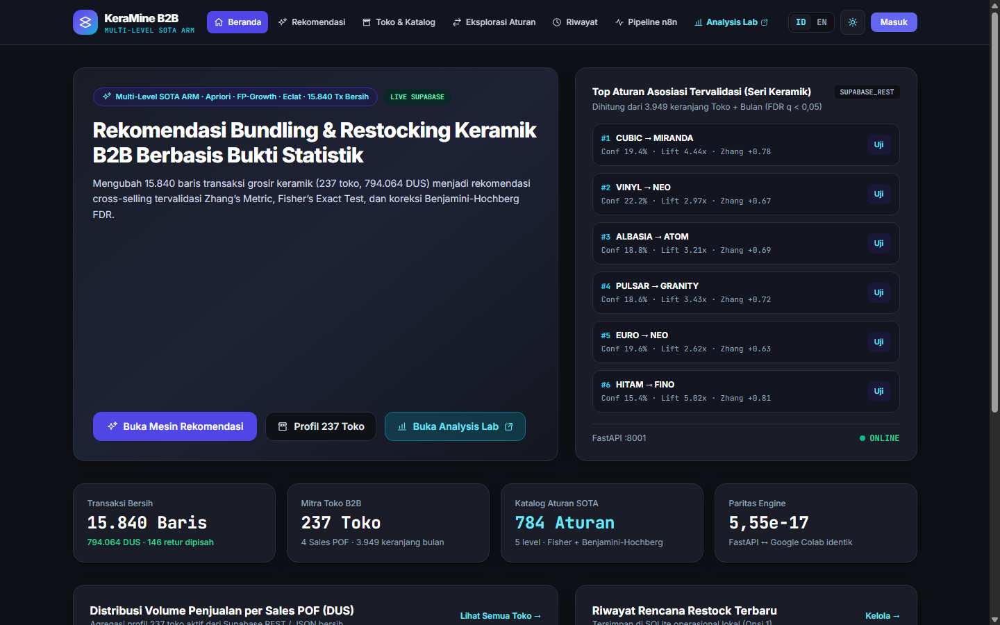
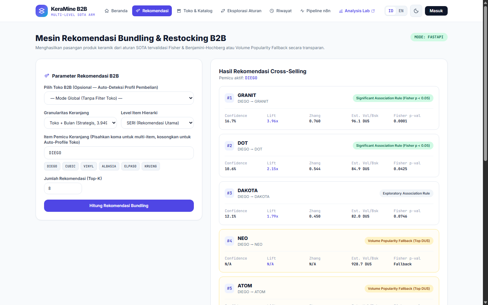
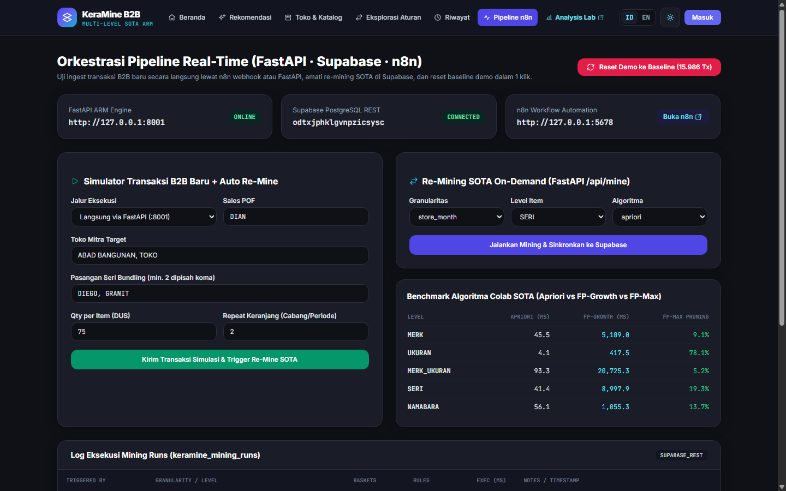
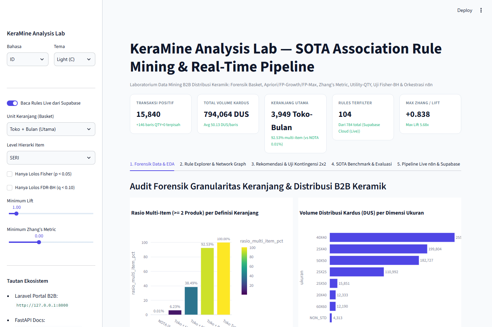
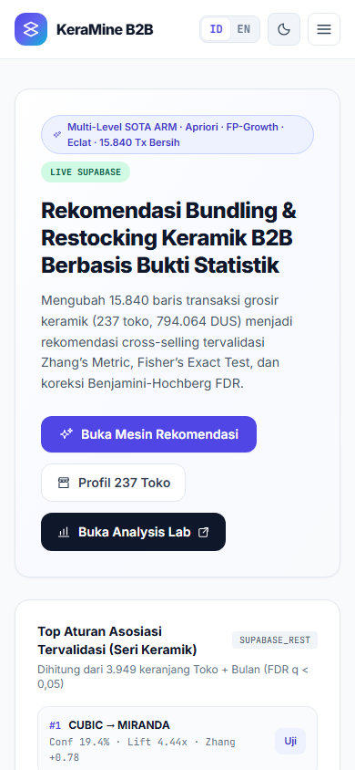

# KeraMine — B2B Ceramic Restocking & Bundling Recommendation System



**KeraMine** is a bilingual (**Indonesian / English**) Multi-Level **State-of-the-Art (SOTA) Association Rule Mining** platform built for wholesale B2B ceramic distribution (**15,840 clean positive transactions**, **794,064 DUS**, **237 partner stores**, **4 Sales POFs**).

It combines a full real-time hybrid architecture across five integrated layers:
- **Laravel 13 (`PHP 8.3`) B2B Portal** (`keramine-laravel/`, port `8000`): Option-1 architecture (local **SQLite** for `users`, `sessions`, and `recommendation_histories` + **Supabase REST HTTPS** & **FastAPI HTTP** with transparent `LIVE SUPABASE` / `LOCAL CLEAN FALLBACK` badges), 1-click role login (`Admin`, `DIAN`, `ROBBY`), 237-Store & Multi-Level Catalog browser, Bundling Recommender + CSV/Print export, 784-Rule Fisher-BH Explorer, and Pipeline Simulator + 1-Click Demo Reset.
- **Streamlit Analysis Lab (`Python 3.13`)** (`keramine-lab/`, port `8501`): 5 interactive analytical tabs covering Basket Granularity Forensics & EDA, Plotly + NetworkX Rule Graph, $2 \times 2$ Contingency Inspector, Apriori/FP-Growth/FP-Max SOTA Benchmark & Out-of-Time Evaluation, and Live n8n/Supabase Monitor.
- **FastAPI Rule Engine** (`api-engine/`, port `8001`): NumPy-vectorized ARM engine with **Zhang’s Metric**, **Utility-Weighted `QTY`**, **Fisher’s Exact Test**, and **Benjamini-Hochberg FDR**, achieving machine-epsilon numerical parity against Google Colab `mlxtend`.
- **n8n Real-Time Pipeline** (`n8n/`, port `5678`): 7-node webhook & scheduled orchestration (`POST /webhook/keramine-ingest`) that ingests simulated/live B2B orders into Supabase, triggers FastAPI `/api/mine`, and returns a structured digest.
- **Supabase Cloud + GitHub Actions Keep-Alive** (`.github/workflows/supabase-keep-alive.yml`): Managed PostgreSQL with Row Level Security (`0` security lints) and automated 3-day ping cron preventing free-tier pause after 7 days of inactivity.

---

## Key Verified Metrics

| Verification Area | Benchmark / Scope | Verified Result |
|---|---|---|
| **Basket Granularity Forensics** | `NOTA` (15,839 baskets) vs `Toko + Bulan` | `NOTA = 0.01%` multi-item (1 random collision `JL*7211.3746`); **`Toko + Bulan = 92.53%`** across `3,949` baskets (avg `3.99` unique SKUs) |
| **Multi-Level SOTA Catalog** | 5 item levels (`MERK`, `UKURAN`, `MERK_UKURAN`, `SERI`, `NAMABARA`) | **`784` rules** exported; **`SERI` = `61/104` Fisher-significant (`p < 0.05`)** (`DIEGO -> GRANIT` Lift `3.96x`, Zhang `+0.760`; `CUBIC -> MIRANDA` Utility `0.310`) |
| **Out-of-Time Predictive Eval** | Temporal train/test split (`Hit-Rate@5`) | Hybrid KeraMine achieves **`66.25%`** (`MERK`) and **`31.50%`** (`MERK_UKURAN`) |
| **Colab ↔ FastAPI Engine Parity** | 10-rule contract (`data/clean/arm_fixture.json`) | **10/10 exact match** ($\max\Delta = \mathbf{5.551 \times 10^{-17}} \le 10^{-6}$, `230.86 ms`) |
| **Laravel Feature Test Suite** | `KeraMinePortalTest` + `ExampleTest` (`RefreshDatabase`) | **7 tests, 59 assertions PASS** (`2,699 ms`) |
| **Streamlit & n8n Live E2E** | `AppTest` + `POST /webhook/keramine-ingest` + `/api/reset-demo` | **`0` UI exceptions**; n8n `HTTP 200` (`403.5 ms` re-mine) & clean reset back to **`15,986` tx / `784` rules** |

---

## Screenshots

| B2B Bundling Recommender (Light Mode) | Pipeline Orchestration & Simulator (Dark Mode) |
|---|---|
|  |  |

| Streamlit Analysis Lab (Forensics & EDA) | Responsive Mobile Portal View |
|---|---|
|  |  |

---

## Supabase Keep-Alive (GitHub Actions)

To prevent Supabase Cloud Free Tier from pausing after 7 days of inactivity, this repository includes [`.github/workflows/supabase-keep-alive.yml`](.github/workflows/supabase-keep-alive.yml), scheduled every 3 days (`0 0 */3 * *`) plus manual `workflow_dispatch`.

After cloning/pushing to GitHub, add these two secrets under **Settings → Secrets and variables → Actions → Repository secrets**:
- `SUPABASE_URL`: `https://<your-project-ref>.supabase.co`
- `SUPABASE_PUBLISHABLE_KEY`: your client-safe Supabase publishable/anon key (`sb_publishable_...`)

Then open the **Actions** tab and run **Supabase Keep-Alive (Anti-Pause 7 Days)** once to verify `HTTP 200`.

---

## Quick Start (Local Installation)

### 1. Clone & Configure Environment
```bash
git clone https://github.com/Eddienxl/KeraMine.git
cd KeraMine
cp .env.example .env
# Fill SUPABASE_URL, SUPABASE_REST_URL, SUPABASE_PUBLISHABLE_KEY, and SUPABASE_SECRET_KEY in .env
```

### 2. Terminal 1 — FastAPI Rule Engine (`http://127.0.0.1:8001/docs`)
```powershell
cd api-engine
py -m pip install -r requirements.txt
py -m uvicorn main:app --host 127.0.0.1 --port 8001
```

### 3. Terminal 2 — Laravel 13 Portal B2B (`http://127.0.0.1:8000`)
> On Windows, if PHP reports `cURL error 60`, ensure OpenSSL `curl.cainfo` points to a CA bundle or copy `certifi`'s `cacert.pem` into `keramine-laravel/storage/app/certs/cacert.pem`.

```powershell
cd keramine-laravel
composer install
Copy-Item .env.example .env
# Copy SUPABASE_* values into keramine-laravel/.env
New-Item -ItemType File -Path database/database.sqlite -Force
php artisan key:generate
php artisan migrate --seed
php artisan serve --host=127.0.0.1 --port=8000
```
Demo credentials (or use 1-Click buttons on `/login`, password: `password`):
- **Warehouse Admin:** `admin@keramine.id`
- **Sales POF DIAN:** `dian@keramine.id` (71 stores)
- **Sales POF ROBBY:** `robby@keramine.id` (55 stores)

### 4. Terminal 3 — Streamlit Analysis Lab (`http://127.0.0.1:8501`)
```powershell
cd keramine-lab
py -m pip install -r requirements.txt
py -m streamlit run app.py --server.port 8501
```

### 5. Terminal 4 — n8n Automation (`http://127.0.0.1:5678`, Optional)
```powershell
npx --yes n8n import:workflow --input=n8n/keramine_realtime_pipeline.json
npx --yes n8n start
```
> Windows shortcut: after completing `.env` and `composer install` / `pip install`, double-click [`start_keramine_demo.bat`](start_keramine_demo.bat) (see [`README_DEMO_UAS.md`](README_DEMO_UAS.md)).

---

## Verification & Test Suites

```powershell
# 1. FastAPI <-> Colab Numerical Contract Parity (<= 1e-6)
py api-engine/tests/test_arm_contract.py

# 2. Laravel Portal B2B Unit & Feature Tests (59 assertions)
cd keramine-laravel
php artisan test

# 3. Streamlit UI AppTest Smoke Check (0 exceptions)
cd ..
py -c "from streamlit.testing.v1 import AppTest; at = AppTest.from_file('keramine-lab/app.py', default_timeout=25); at.run(); assert not at.exception"
```

---

## Repository Structure

```text
KeraMine/
├── .github/workflows/                 # Supabase 3-day keep-alive cron (supabase-keep-alive.yml)
├── api-engine/                        # FastAPI SOTA ARM microservice, Supabase REST client & parity tests
├── keramine-laravel/                  # Laravel 13 B2B Portal (Option 1 SQLite + Supabase REST/FastAPI + PHPUnit)
├── keramine-lab/                      # Streamlit 5-tab Analysis Lab (Plotly EDA, NetworkX Graph, 2x2 Inspector)
├── n8n/                               # 7-node workflow export (keramine_realtime_pipeline.json) & setup guide
├── notebooks/                         # Google Colab 01 (Cleaning & Basket Eng.) & 02 (SOTA ARM Validation)
├── data/clean/                        # Clean CSV/JSON artifacts, store profiles (237), rules (784) & arm_fixture.json
├── assets/                            # Colab analytical charts (figures/) & UI captures (screenshots/)
├── Master_Dokumentasi_ADAMIN_KeraMine/# Full PRD, Design System, Architecture, Agents & Pipeline specs (01-08)
├── Laporan_UAS_ADAMIN_KeraMine.html   # Complete academic UAS report (Bab 1-5 + Tabel 4.1-4.7 + Gambar 4.1-4.7)
├── start_keramine_demo.bat            # 1-Click Windows full-stack demo launcher
├── README_DEMO_UAS.md                 # UAS presentation & walkthrough guide
└── LICENSE                            # MIT License + academic dataset notice
```

---

## Author & License

- **Author:** Ahmad Fadli Pratama ([`@Eddienxl`](https://github.com/Eddienxl)) — NIM. `12350111030`  
  Informatics Engineering, Faculty of Science and Technology, Universitas Islam Negeri Sultan Syarif Kasim Riau (UIN Suska Riau)
- **Software License:** [MIT License](LICENSE)
